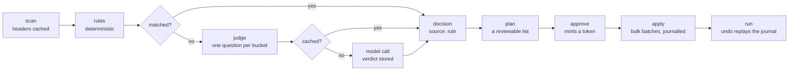

# How Damien works

Damien decides what each message in a Gmail mailbox is, writes down why, and lets one
person approve the writes before any of them happen.

It is one person's mailbox on one machine. It talks to Gmail and to a model, and to
nothing else. There is no server, no daemon and no account besides the mailbox itself.

## The pipeline

Six things are worth knowing about that shape:

1. **Nothing is written to Gmail until `apply`.** `plan build` and `rules plan` write to
   Damien's own store. A plan is a document, not a change.
2. **Rules run first, and they are free.** A rule is a deterministic match — a sender, a
   label, a list header, an age. What a rule decides costs nothing and never varies.
3. **The model only sees what the rules left.** It answers one question per message by
   choosing among the buckets (see `POLICY.md`), and every verdict is stored, so the same
   message is never judged twice for the same spec.
4. **A decision records who made it.** `rule`, `person`, `jev` (the model) or `default` —
   and `person` always wins over `rule`, which wins over the model, in both passes.
5. **Every write is journalled before it happens.** Each batch row is written `pending`
   before the Gmail call and flipped to `done` after, with the state each message had when
   the plan was built (inbox, unread, label). `run undo` replays pending and done batches and
   restores exactly that state, not a guess; plans from before 0.4.0 fall back to the fixed
   inverse. An undone run cannot be undone twice.
6. **Confidence gates the automatic path.** A model decision at or above
   `DAMIEN_CONFIDENCE_ACT` (default 0.80) may be applied unattended; below it the message
   is kept and handed to a person. `damien pass` uses the threshold `damien judge eval`
   calibrated for the model and host instead. Rules and your own corrections always pass.

## The two passes

There are two ways to build a plan, and they are not variations of each other — they are
for different jobs.

| pass | what it does | cost | when |
|---|---|---|---|
| `damien rules plan` | every rule, one Gmail query per translatable rule; `snippet`/`any` rules in Python | **free**, no model | migrating a mailbox; anything over ~10k messages |
| `damien plan build` | rules, then the model on everything they left | **≈$0.05 per 1,000 judgments** | a new mailbox, or mail no rule covers yet |

A hundred thousand messages are a hundred Gmail listings and a few bulk writes for the
rules pass — about a minute. The same mailbox through `plan build` is hours and real
money, which is why the rules pass exists and why `rules from-senders` matters: every
sender made permanent is a sender never judged again.

The rules pass keeps your corrections on top, applies `DAMIEN_PROTECT_LABELS` and the
guardrail exclusions to every non-person rule, quotes label names in its queries, and skips
(and prints) any rule shadowed by a Python-only rule.

`damien pass weekly|monthly` is the scheduled pass: it builds a plan for the window, approves
it in-process, and applies only rules, person corrections and model decisions at or above
the calibrated threshold; everything else is reported as waiting. With no calibration for
the model it applies rules and corrections only and says to run `damien judge eval`.

The judge is any decision model with the Jev contract: `DAMIEN_JUDGE=openrouter`,
`typesafe`, `local` (`DAMIEN_JUDGE_URL`; nothing leaves the machine), `rules` (no model) or
`fake` (tests). A backend that returns no confidence is rejected, and a failed judgment is
never cached — the message stays for a person.

Measured, on this mailbox: 3,709 model calls cost **$0.1713** — about **$0.000046 a
message**. The cache means a second pass over the same mail costs nothing.

## The store

State lives in `~/.damien` (or wherever `DAMIEN_HOME` points). One SQLite file by
default; a Postgres URL instead if `DAMIEN_DB_URL` is set. The tables, and what each is
for:

| table | holds |
|---|---|
| `messages` | the headers Damien has seen: sender, subject, labels, list headers, age |
| `decisions` | one row per message per pass: the action, the source, the rationale, the confidence |
| `verdicts` | the model's answers, **cached** — keyed by the message and the spec, so a spec change re-judges and nothing else does |
| `plans` / `plan_items` | a plan: its query, its status, its token hash, and one row per message with the action decided |
| `runs` / `run_batches` | what was actually applied to Gmail: one row per batch, with the inverse of the write |
| `corrections` | what a person said a message should have been — the training signal |
| `message_embeddings` | vectors, used only to group a plan for review |

Gmail credentials are `credentials.json` (the OAuth desktop client) and `token.json`
(written by `damien login`). The scope requested is
`https://www.googleapis.com/auth/gmail.modify` — read, label, archive and trash. It cannot
delete permanently, and it grants nothing in Drive, Calendar or Tasks. Google's description
of that scope also includes composing and sending, which no code path here uses: the token
is a credential, and treat it like one.

## What Damien will not do

- **Delete anything permanently.** `trash` moves a message to the Trash label, which
  Gmail clears after thirty days. The window is the undo. The scope cannot do more: Google
  says `gmail.modify` "does not allow immediate, permanent deletion of threads and
  messages, bypassing the trash".
- **Send mail.** No code path sends and no command does. The scope is a different matter —
  Google describes `gmail.modify` as "read, compose, and send emails", so the token file is
  a credential that *could* send even though nothing here does. That is why it lives at
  0600 in `~/.damien`, and why the scope is not widened.
- **Touch Drive, Calendar or Tasks.** Those are separate APIs with separate scopes; this
  token grants nothing in any of them.
- **Write without a token.** `plan apply` refuses without the token minted by
  `plan approve` — printed once, stored only as its sha256 hash, never shown by `plan show`;
  approving again mints a fresh one — and refuses a second time on a plan already applied.
- **Judge a message twice for the same spec.** The verdict cache is keyed on it.
- **Act on a low-confidence guess.** Below the threshold it keeps the message and says so.
